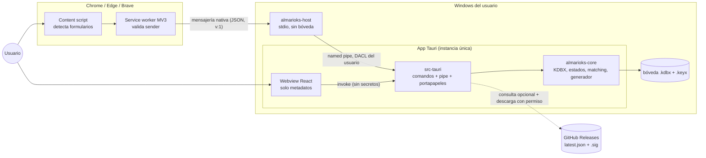

# AlmarioKS — arquitectura (E3 · L · riesgo alto) · 2026-11-11
Decisiones de una vía en `docs/adr/0001` a `0005`. Amenazas en `docs/AMENAZAS.md`. Stack: Tauri 2.12.x + React/TS (Vite).

## Contenedores (C4 nivel 2)


## Crates y carpetas propuestos
```
almarioks/
├─ Cargo.toml              # workspace, lints del estándar (R-2), keepass =0.17.0
├─ crates/
│  ├─ almarioks-core/      # sin Tauri ni red: kdbx/ (4 envolturas), vault (estados), matching, generator
│  ├─ almarioks-protocol/  # mensajes versionados host <-> app (serde)
│  └─ almarioks-host/      # binario de mensajería nativa; depende solo de protocol
├─ src-tauri/              # app: commands/, ipc_pipe/, clipboard/, ffi/ (unsafe aislado, R-7), capabilities/
├─ src/                    # React + Vite (webview)
├─ extension/              # MV3: service worker + content script, sin secretos guardados
├─ installer/              # hooks NSIS: manifiesto y claves HKCU de mensajería nativa
└─ docs/  adr/  .github/workflows/
```

## Atributos de calidad que mandan
| # | Atributo | Meta | Se verifica con |
|---|---|---|---|
| 1 | Compatibilidad KDBX sin pérdida | 0 líneas distintas en la ida y vuelta del corpus (KeePass 2.62 medido; KeePassXC en el H0) | `cargo nextest run -p almarioks-core --test roundtrip` |
| 2 | Secretos fuera de la webview y bloqueo que no falla abierto | 0 apariciones del canario en las respuestas IPC (salvo `reveal_field`) y en disco; el volcado de WebView2 se mide y se anota (AMENAZAS W2); bloquear con guardado fallido termina en `Locked` | prueba canario + prueba de E3-3 + E3-9 |
| 3 | Entrega confiable | N → N+1 instala sin intervención extra en VM limpia; `.sig` alterado rechazado (100 %) | prueba manual del H0 (ADR-0003), luego script en CI |

Metas secundarias (propuesta, se calibran en el H0): desbloqueo con Argon2id ≤ 1 s y arranque en frío hasta la pantalla
de desbloqueo ≤ 2 s en el PC de referencia; rellenar ≤ 500 ms p95 con la bóveda abierta (0.2).

## Fitness functions (para la Constitución)
1. `cargo tree -p almarioks-core -i tauri` → vacío (Constitución 8).
2. `cargo tree -p almarioks-host -e normal | grep -E "almarioks-core|keepass"` → vacío.
3. `cargo clippy --all-targets -- -D warnings` + `cargo deny check` + la prueba canario, todo con `--locked`.

## Lo que NO se decidió (reversible: una línea en la spec de su fase)
- Tiempos de bloqueo automático y de limpieza del portapapeles; formato exacto para excluirlo del historial de Windows (0.1).
- Archivo llave obligatorio u opcional (pregunta abierta 1 de la visión; no cambia el formato).
- Aviso "¿guardar?" dentro de la página o en la app (pregunta 2; UX, 0.2).
- Copia de seguridad antes de guardar (`.bak`) y cuántas guardar (0.1).
- Formato de la llave de asociación y del código de emparejamiento; si el anfitrión abre la app cuando está cerrada (0.2).
- Heurística para "creando cuenta" y la lista de los 20 sitios (0.2).
- Gestor de estado de React, librería de UI e i18n (técnicas reversibles; las decide `react-next-engineer`).
- Microsoft Store/MSIX u OV: solo si SignPath rechaza (ADR-0004; es gasto o cuenta: decide el usuario).
- WebView2 `offlineInstaller`: solo si aparecen usuarios sin internet al instalar.
