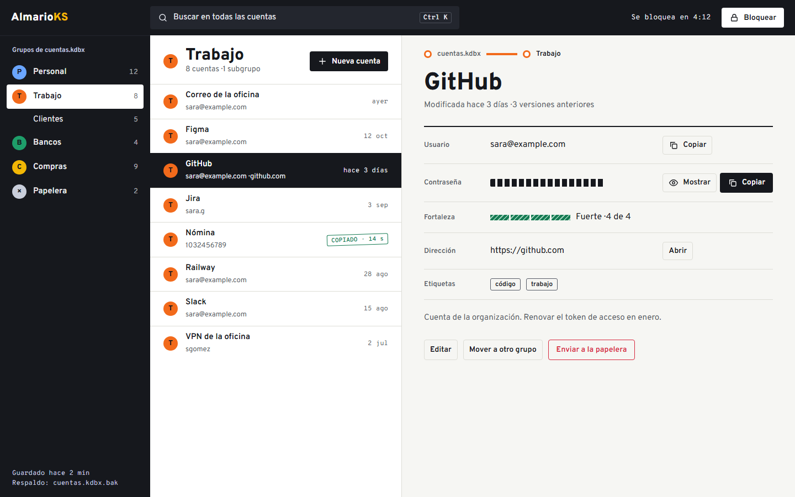
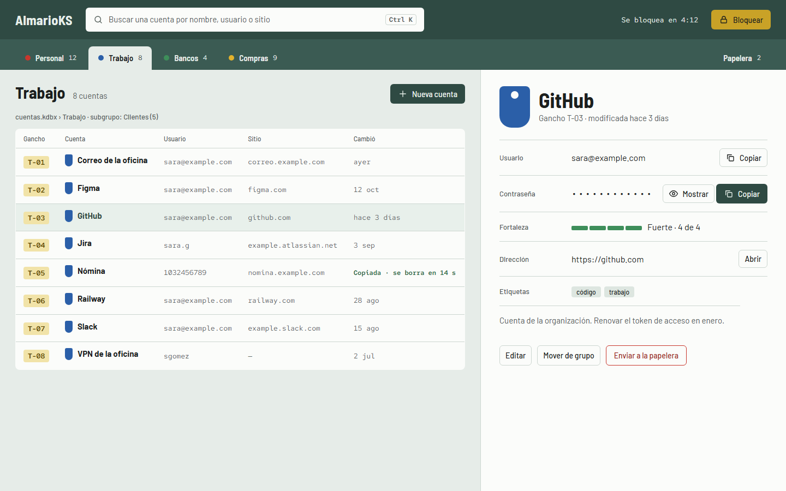
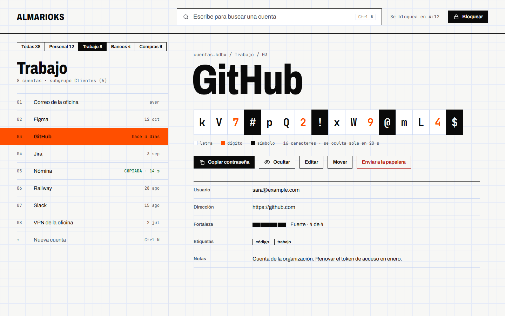
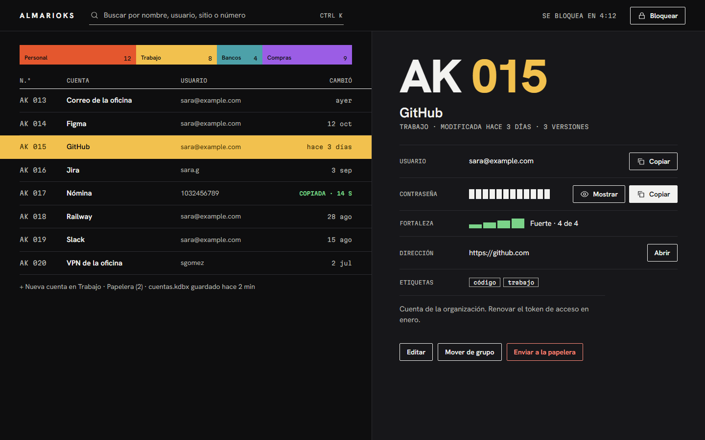
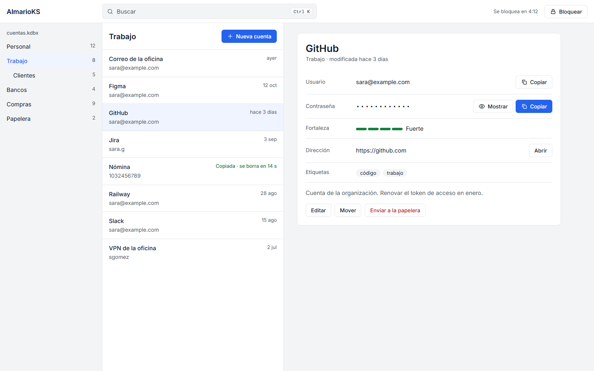

# AlmarioKS — direcciones visuales para escoger (2026-11-11)

> Preparado con `/impeccable shape` sin entrevista en vivo: el dueño no estaba. **Nada de esto está decidido ni
> construido.** La interfaz de la 0.1 sigue funcional y sin dirección hasta que él escoja una (decisión D11 de la spec
> 001). Los bocetos muestran la misma pantalla, con los mismos datos falsos: la bóveda abierta (P4) con la cuenta
> "GitHub" seleccionada. Son bocetos de la primera pantalla, no la interfaz final.

## Brief (lo que cualquier dirección tiene que cumplir)
- **Quién y para qué:** una persona en su PC, a veces con gente al lado, que entra por segundos a buscar una cuenta y
  copiar su contraseña sin verla. Es una pantalla de trabajo: primero se entiende dónde está cada cosa, después se
  nota el estilo.
- **Lo que debe quedar claro de un vistazo:** dónde busco, en qué grupo estoy, qué cuenta tengo seleccionada, cómo
  copio, cuándo se borra lo copiado y cuándo se bloquea la app.
- **Lo que no puede prometer:** "seguro", "auditado" ni candados y escudos de adorno. Las 0.x son de desarrollo.
- **Estados que la dirección debe resolver:** bloqueada, vacía, copiado con cuenta regresiva, guardado fallido,
  solo lectura, contraseña oculta y mostrada, fortaleza.
- **Restricciones:** CSP sin estilos en línea, fuentes e iconos libres y empaquetados, tema claro y oscuro,
  contraste AA, todo con teclado, ventana mínima de 480 × 360.
- **Supuestos sin confirmar:** que la tarea principal es buscar y copiar (sale de `docs/UX.md`); que el público no es
  técnico (sale de la visión).

## Cómo se armó la mano
Se listaron siete mundos que la gente que guarda cosas importantes conoce de memoria (tablero de llaves de portería,
libreta de teléfonos con índice, papel de seguridad, señalización de transporte, fichero de biblioteca, apartados
postales y el armario mismo). Un dado escogió cuál se desarrolla, para no caer siempre en la favorita de la
directora, y el catálogo de Impeccable repartió seis retadores ajenos: dos aguantaron la comparación y entran como
alternas; cuatro perdieron y dejaron una idea cada uno.

## Las cinco opciones

### 1. Señalética (la que asignó el dado)

Cada grupo es una línea con su color: una cuenta se encuentra como se encuentra un andén. Riel negro de señal, colores
de línea por grupo, tipografía de señalización (Overpass, OFL).
- **Lo que se quedó de los retadores que perdieron:** el estado se estampa en la fila y no desaparece ("copiado ·
  14 s"); la fortaleza se lee por trama y texto, no solo por color; la contraseña oculta es una barra de ancho fijo
  que no delata su longitud; existe densidad compacta para bóvedas grandes.
- **Riesgo:** los colores de línea compiten con los de estado si el rojo no se reserva para peligro.

### 2. Tablero de llaves (la favorita de la directora antes del dado)

Cada cuenta es una llave en su gancho numerado, con etiqueta de color. Verde de tablero, latón, grupos como pestañas.
- **Riesgo:** es la metáfora más directa de la categoría; puede leerse literal si se dibuja de más.

### 3. Retícula (retador que aguantó)

La contraseña mostrada se compone celda por celda sobre una retícula visible, con dígitos y símbolos distinguidos.
Búsqueda primero, lista densa, detalle amplio.
- **A favor:** es la que mejor resuelve leer una contraseña sin confundir `0` con `O`.
- **Riesgo:** fría y de nicho; es un mundo de diseñadores.

### 4. Catálogo mate (retador que aguantó)

Negro mate, cada cuenta con su número de catálogo y solo la activa a color. Es la única opción oscura primero.
- **Riesgo:** el tema claro queda como invitado; los números de catálogo son un invento que hay que sostener.

### 5. El estándar de la categoría (la puerta de salida)

Lo que traen Bitwarden y 1Password, bien ejecutado: grises neutros, un azul, tres paneles.
- **Riesgo:** indistinguible de los demás, por diseño.

## Lo que opina la directora
Antes del dado mi favorita era el Tablero de llaves. Después de ver las cinco renderizadas, **recomiendo
Señalética**: es la que se lee más rápido, usa el color para algo (saber en qué grupo estoy) y tiene carácter sin
disfrazar la pantalla. La Retícula tiene la mejor idea para mostrar la contraseña; si te gusta, se puede evaluar esa
sola pieza dentro de la dirección que escojas, pero eso se decide después de escoger el mundo, no antes.

## Decisión (2026-11-11, noche)
El dueño leyó la recomendación y respondió con una autorización general, sin nombrar una opción. La directora lo
tomó como vía libre a **Señalética** y la aplica sobre la interfaz ya funcional. Es reversible: los otros bocetos
siguen aquí y cambiar de mundo toca tokens y composición, no la lógica. El contrato de dirección está en
`.impeccable/surfaces/`.

## Cómo escoger
Responde con el nombre de una opción, o pide otra mano ("más segura" o "más atrevida"). Los bocetos en HTML están en
`docs/diseno/mocks/` para abrirlos a tamaño real (1440 × 900). Insumos previos: `docs/diseno/referencias.md`.

## Pendiente después de escoger
Contrato de dirección, tokens, pantallas P1 a P8 en esa dirección, tema oscuro y claro, marca (icono y logo con
`brand-designer`) y `DESIGN.md` al final. Las fuentes de los bocetos se cargan de Google Fonts solo para el boceto: en
la app van empaquetadas, tras verificar su licencia.
